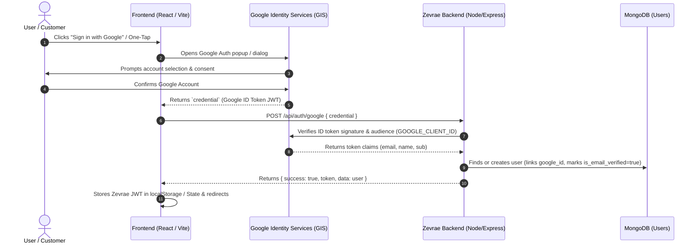

# Frontend Google Authentication Implementation Report & Guide
**Project:** Zevrae E-Commerce Platform  
**Target:** Frontend Integration for `POST /api/auth/google`  
**Date:** October 2026  
**Status:** Ready for Implementation

---

## 1. Executive Summary & Architecture Overview

The Zevrae backend is already fully configured with `google-auth-library` to accept a Google ID token (`credential`), verify it cryptographically against Google's OAuth2 servers, and issue a platform JWT token.



---

## 2. Backend Contract Specification

### Endpoint
- **URL:** `POST /api/auth/google`
- **Headers:** `Content-Type: application/json`
- **CORS Allowed Origins:**
  - `http://localhost:5173` (Vite dev)
  - `http://localhost:3000` (Create-React-App / Next.js)
  - `http://localhost:5000` / `5050`
  - `https://zevrae.com` / `https://www.zevrae.com`

### Request Payload
```json
{
  "credential": "eyJhbGciOiJSUzI1NiIsImtpZCI6..."
}
```
> **Note:** The backend specifically expects the field name `credential` (the standard ID token returned by Google Identity Services).

### Response Payloads

#### Success (`200 OK`)
```json
{
  "success": true,
  "token": "eyJhbGciOiJIUzI1NiIsInR5cCI6IkpXVCJ9...",
  "data": {
    "_id": "671fb2c4e92a8b3e10ab45cd",
    "name": "Rahul Verma",
    "email": "rahul@example.com",
    "role": "customer",
    "auth_provider": "google",
    "is_email_verified": true,
    "is_active": true
  }
}
```

#### Error Responses
- **`400 Bad Request`**: `{ "success": false, "message": "Google credential is required" }`
- **`401 Unauthorized`**: `{ "success": false, "message": "Invalid or expired Google credential" }` or `"Google email is not verified"`
- **`403 Forbidden`**: `{ "success": false, "message": "Account is deactivated" }`
- **`503 Service Unavailable`**: `{ "success": false, "message": "Google sign-in is not configured on the server (missing GOOGLE_CLIENT_ID)" }`

---

## 3. Google Cloud Console Configuration

Before frontend code will work, you must obtain a **Google Client ID**:

1. Go to **[Google Cloud Console](https://console.cloud.google.com/)** > **APIs & Services** > **Credentials**.
2. Click **Create Credentials** > **OAuth client ID**.
3. Application type: **Web application**.
4. Set **Authorized JavaScript origins**:
   - `http://localhost:5173` (for local Vite development)
   - `http://localhost:3000` (if using React default or Next.js)
   - `https://zevrae.com` (production)
   - `https://www.zevrae.com` (production)
5. Set **Authorized redirect URIs**:
   - (Google Identity Services popup flow does not require redirect URIs, but you can set `http://localhost:5173` and `https://zevrae.com` to prevent warnings).
6. Copy the **Client ID** (e.g., `1234567890-abcdefgh.apps.googleusercontent.com`).
7. **Ensure identical Client IDs**:
   - Backend `.env`: `GOOGLE_CLIENT_ID=1234567890-abcdefgh.apps.googleusercontent.com`
   - Frontend `.env`: `VITE_GOOGLE_CLIENT_ID=1234567890-abcdefgh.apps.googleusercontent.com`
   > ⚠️ **Warning:** If they do not match exactly, the backend will reject tokens with `Wrong recipient / audience mismatch`.

---

## 4. Implementation Option A: React + Vite (Recommended)

This is the cleanest, modern approach using Google's official recommended wrapper for React (`@react-oauth/google`).

### Step 4.1: Install Dependencies
```bash
npm install @react-oauth/google axios
```

### Step 4.2: Frontend `.env`
Create or update `.env` in the frontend root:
```env
VITE_API_BASE_URL=http://localhost:5000/api
VITE_GOOGLE_CLIENT_ID=your-google-client-id-here.apps.googleusercontent.com
```

### Step 4.3: Wrap App in `GoogleOAuthProvider`
In your `src/main.jsx` (or `src/App.jsx`):
```jsx
import React from 'react';
import ReactDOM from 'react-dom/client';
import { GoogleOAuthProvider } from '@react-oauth/google';
import App from './App';
import './index.css';

const GOOGLE_CLIENT_ID = import.meta.env.VITE_GOOGLE_CLIENT_ID;

ReactDOM.createRoot(document.getElementById('root')).render(
  <React.StrictMode>
    <GoogleOAuthProvider clientId={GOOGLE_CLIENT_ID}>
      <App />
    </GoogleOAuthProvider>
  </React.StrictMode>
);
```

### Step 4.4: Authentication Service / API helper
In `src/services/authService.js`:
```javascript
import axios from 'axios';

const API_BASE_URL = import.meta.env.VITE_API_BASE_URL || 'http://localhost:5000/api';

/**
 * Sends Google credential (ID Token) to Zevrae Backend
 * @param {string} credential - Google JWT ID Token
 */
export const loginWithGoogle = async (credential) => {
  const response = await axios.post(`${API_BASE_URL}/auth/google`, {
    credential,
  });
  return response.data; // { success: true, token, data: user }
};
```

### Step 4.5: Google Login Button Component
In `src/components/GoogleLoginButton.jsx`:
```jsx
import React, { useState } from 'react';
import { GoogleLogin } from '@react-oauth/google';
import { loginWithGoogle } from '../services/authService';

export default function GoogleLoginButton({ onSuccess, onError }) {
  const [loading, setLoading] = useState(false);
  const [errorMessage, setErrorMessage] = useState('');

  const handleGoogleSuccess = async (credentialResponse) => {
    try {
      setLoading(true);
      setErrorMessage('');

      // credentialResponse contains: { credential, clientId }
      const { credential } = credentialResponse;
      if (!credential) {
        throw new Error('No credential received from Google.');
      }

      // Call Zevrae backend
      const result = await loginWithGoogle(credential);

      if (result.success) {
        // Save token to localStorage / Auth state
        localStorage.setItem('zevrae_token', result.token);
        localStorage.setItem('zevrae_user', JSON.stringify(result.data));

        if (onSuccess) {
          onSuccess(result);
        }
      }
    } catch (err) {
      const msg = err.response?.data?.message || err.message || 'Google sign-in failed';
      setErrorMessage(msg);
      if (onError) onError(msg);
    } finally {
      setLoading(false);
    }
  };

  const handleGoogleFailure = () => {
    const msg = 'Google authentication popup was closed or cancelled.';
    setErrorMessage(msg);
    if (onError) onError(msg);
  };

  return (
    <div className="google-auth-container flex flex-col items-center">
      {loading && <p className="text-sm text-gray-500 mb-2">Signing in with Google...</p>}
      
      <GoogleLogin
        onSuccess={handleGoogleSuccess}
        onError={handleGoogleFailure}
        theme="outline"        // or 'filled_blue', 'filled_black'
        size="large"           // 'small', 'medium', 'large'
        shape="rectangular"    // 'circle', 'pill', 'rectangular'
        text="continue_with"   // 'signin_with', 'signup_with', 'continue_with'
        useOneTap={true}       // Displays the One-Tap prompt automatically!
      />

      {errorMessage && (
        <p className="mt-2 text-sm text-red-600 font-medium">{errorMessage}</p>
      )}
    </div>
  );
}
```

### Step 4.6: Custom UI Button (Alternative with `useGoogleLogin`)
If you want to style your own custom branded button instead of the Google-rendered iframe button:
```jsx
import React from 'react';
import { useGoogleLogin } from '@react-oauth/google';
import { loginWithGoogle } from '../services/authService';

export default function CustomGoogleButton({ onLoginSuccess }) {
  // Use 'id_token' flow for direct backend JWT verification
  const login = useGoogleLogin({
    onSuccess: async (tokenResponse) => {
      // tokenResponse.credential contains the ID token
      try {
        const result = await loginWithGoogle(tokenResponse.credential);
        localStorage.setItem('zevrae_token', result.token);
        localStorage.setItem('zevrae_user', JSON.stringify(result.data));
        if (onLoginSuccess) onLoginSuccess(result);
      } catch (err) {
        console.error('Login error:', err);
      }
    },
    onError: (err) => console.error('OAuth Failed:', err),
    flow: 'implicit', // or standard GIS popup
  });

  return (
    <button
      onClick={() => login()}
      className="flex items-center justify-center gap-2 px-4 py-2 border border-gray-300 rounded-lg shadow-sm hover:bg-gray-50 transition"
    >
      
      <span className="text-sm font-medium text-gray-700">Continue with Google</span>
    </button>
  );
}
```

---

## 5. Implementation Option B: Vanilla JavaScript / Plain HTML

If your frontend is vanilla HTML/JS without React:

### Step 5.1: Add Google Identity Services Script in `<head>`
```html
<script src="https://accounts.google.com/gsi/client" async defer></script>
```

### Step 5.2: Add HTML Container
```html
<!-- Google Button will be rendered here -->
<div id="googleBtn"></div>
```

### Step 5.3: Initialize and Handle Response
```javascript
window.onload = function () {
  const GOOGLE_CLIENT_ID = "YOUR_GOOGLE_CLIENT_ID.apps.googleusercontent.com";
  const API_URL = "http://localhost:5000/api/auth/google";

  // 1. Initialize Google Identity Services
  google.accounts.id.initialize({
    client_id: GOOGLE_CLIENT_ID,
    callback: handleCredentialResponse,
    auto_select: false,
    cancel_on_tap_outside: true,
  });

  // 2. Render Google Button
  google.accounts.id.renderButton(
    document.getElementById("googleBtn"),
    { theme: "outline", size: "large", text: "continue_with" }
  );

  // 3. Optional: Trigger Google One-Tap floating prompt
  google.accounts.id.prompt();
};

// 4. Callback when Google returns the credential
async function handleCredentialResponse(response) {
  try {
    const res = await fetch("http://localhost:5000/api/auth/google", {
      method: "POST",
      headers: { "Content-Type": "application/json" },
      body: JSON.stringify({ credential: response.credential }),
    });

    const data = await res.json();
    if (data.success) {
      localStorage.setItem("zevrae_token", data.token);
      localStorage.setItem("zevrae_user", JSON.stringify(data.data));
      window.location.href = "/dashboard"; // or homepage
    } else {
      alert("Google login failed: " + data.message);
    }
  } catch (err) {
    console.error("Network or Auth error:", err);
  }
}
```

---

## 6. Implementation Option C: Next.js (App Router or Pages Router)

### Step 6.1: Setup `next.config.js` / Environment
In `.env.local`:
```env
NEXT_PUBLIC_GOOGLE_CLIENT_ID=your-google-client-id.apps.googleusercontent.com
NEXT_PUBLIC_API_URL=http://localhost:5000/api
```

### Step 6.2: App Router Layout (`app/layout.jsx`)
```jsx
'use client';
import { GoogleOAuthProvider } from '@react-oauth/google';

export default function RootLayout({ children }) {
  return (
    <html lang="en">
      <body>
        <GoogleOAuthProvider clientId={process.env.NEXT_PUBLIC_GOOGLE_CLIENT_ID}>
          {children}
        </GoogleOAuthProvider>
      </body>
    </html>
  );
}
```

---

## 7. Common Pitfalls & Troubleshooting Checklist

| Issue | Cause | Fix |
|---|---|---|
| **`401 Invalid or expired Google credential` (Server logs: `Wrong recipient / audience mismatch`)** | `GOOGLE_CLIENT_ID` in backend `.env` does not match `VITE_GOOGLE_CLIENT_ID` in frontend `.env`. | Ensure both `.env` files contain the exact same Google Client ID without extra spaces or line breaks. |
| **`503 Google sign-in is not configured on the server`** | Backend `GOOGLE_CLIENT_ID` is empty or missing in `.env`. | Add `GOOGLE_CLIENT_ID=...` to the backend `.env` and restart the backend server. |
| **`[GSI_LOGGER]: The given origin is not allowed...`** | Current frontend URL (e.g. `http://localhost:5173`) is not added to Google Cloud Console. | Open Google Cloud Console > Credentials > OAuth Client > Add `http://localhost:5173` to **Authorized JavaScript origins**. |
| **CORS Error in browser console** | Frontend is calling backend from an unwhitelisted port/domain. | Verify your frontend port matches `allowedOrigins` in `server.js` (`localhost:5173`, `localhost:3000`, `zevrae.com`). |
| **`Cross-Origin-Opener-Policy` warning** | Browser COOP headers conflict with popup window. | Backend `server.js` already includes `crossOriginOpenerPolicy: { policy: "same-origin-allow-popups" }`. Ensure the frontend dev server does not set strict `COOP: same-origin`. |
| **User already registered with local email & password** | User originally signed up with email/password, then uses Google with the same email. | **Already handled!** Zevrae backend automatically detects matching email, links `google_id`, sets `is_email_verified = true`, and logs them in seamlessly. |

---

## 8. Verification & QA Steps

1. **Verify Backend Env:** Ensure `GOOGLE_CLIENT_ID` is populated in `Backend/.env`.
2. **Start Backend:** `npm run dev` (confirm log: `[auth] Google sign-in configured for client ID ending in …XXXX`).
3. **Start Frontend:** `npm run dev` on `http://localhost:5173`.
4. **Trigger Login:** Click the Google button, choose an account.
5. **Verify Network Tab:**
   - Look for request: `POST /api/auth/google` with payload `{ credential: "..." }`.
   - Status: `200 OK`.
   - Response contains: `success: true`, `token` (JWT), and `data` (User object).
6. **Verify Storage:** Check `localStorage` has `zevrae_token`.
7. **Verify Subsequent Requests:** Subsequent requests to protected routes (`/api/cart`, `/api/orders`) send header:
   ```http
   Authorization: Bearer <zevrae_token>
   ```
